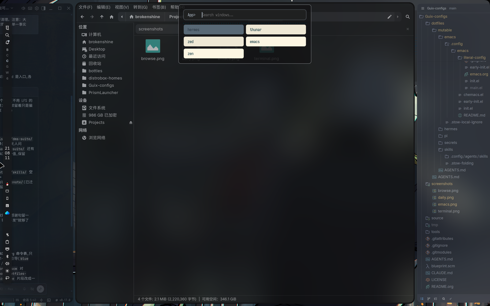
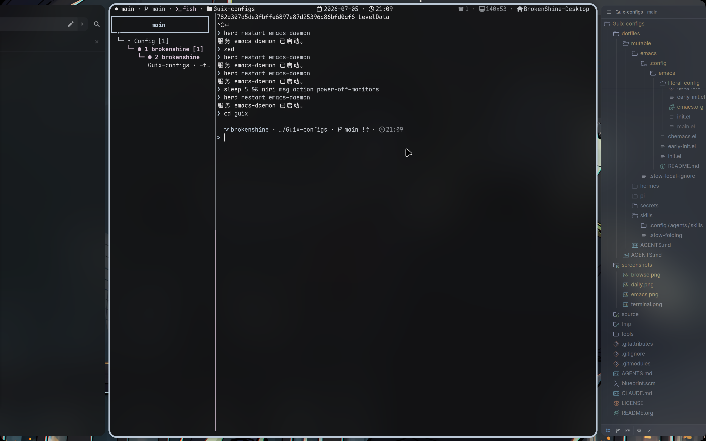
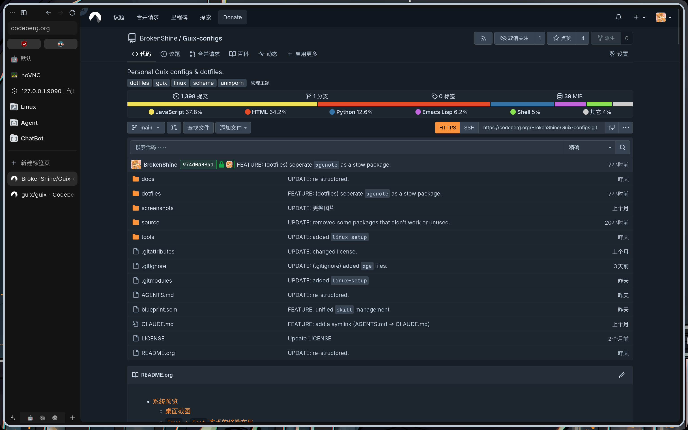

# SPDX-FileCopyrightText: 2026 BrokenShine <xchai404@gmail.com>
#
# SPDX-License-Identifier: MIT

#+begin_example
▗▄▄▖  ▄▄▄ ▄▄▄  █  ▄ ▗▞▀▚▖▄▄▄▄   ▗▄▄▖▐▌   ▄ ▄▄▄▄  ▗▞▀▚▖  ▄   ▄▄▄
▐▌ ▐▌█   █   █ █▄▀  ▐▛▀▀▘█   █ ▐▌   ▐▌   ▄ █   █ ▐▛▀▀▘     ▀▄▄
▐▛▀▚▖█   ▀▄▄▄▀ █ ▀▄ ▝▚▄▄▖█   █  ▝▀▚▖▐▛▀▚▖█ █   █ ▝▚▄▄▖     ▄▄▄▀
▐▙▄▞▘          █  █            ▗▄▄▞▘▐▌ ▐▌█
                                           ▗▄▄▖█  ▐▌▄ ▄   ▄
                                          ▐▌   ▀▄▄▞▘▄  ▀▄▀
                                          ▐▌▝▜▌     █ ▄▀ ▀▄
                                          ▝▚▄▞▘     █
                                          ▗▄▄▖▄▄▄  ▄▄▄▄  ▗▞▀▀▘ ▄   █  ▐▌ ▄▄▄ ▗▞▀▜▌   ■  ▄  ▄▄▄  ▄▄▄▄
                                         ▐▌  █   █ █   █ ▐▌    ▄   ▀▄▄▞▘█    ▝▚▄▟▌▗▄▟▙▄▖▄ █   █ █   █
                                         ▐▌  ▀▄▄▄▀ █   █ ▐▛▀▘  █        █           ▐▌  █ ▀▄▄▄▀ █   █
                                         ▝▚▄▄▖           ▐▌    █ ▗▄▖                ▐▌  █
                                                                ▐▌ ▐▌               ▐▌
                                                                 ▝▀▜▌
                                                                ▐▙▄▞▘
#+end_example

#+begin_quote
以文学编程（Literate Programming）构建的模块化 GNU Guix 个人系统配置。整台机器的系统层（ =operating-system= ）与用户态（ =home-environment= ）统一在 [[./source/config.org][source/config.org]] 中声明，借由任务运行器 =blue= 自动抽离 Scheme 代码并完成一键构建与部署。
#+end_quote

--------------

* 系统预览与技术栈

| 组件       | 方案                             |
|------------+----------------------------------|
| 内核       | =linux-cachyos-lts= （本地定制） |
| 引导器     | =Limine= （ =rosenthal= 频道）   |
| 窗口合成器 | =Niri= （Wayland）               |
| 登录管理器 | =Greetd= + =tuigreet=            |
| 终端环境   | =Kitty= + =Tmux= + =Fish=        |
| 编辑器     | =Emacs= / =Zed= / =Helix=        |
| 输入法     | =Fcitx5= + =Rime=                |
| 主力字体   | =Sarasa Gothic= / =Maple Mono=   |

- 桌面日常（ =Niri= ）::
  
- 终端工作区（ =Tmux= ）::
  
- 网页浏览（ =Zen Browser= ）::
  

* 设计概览

在动手修改配置前，只需把握本仓库的三个核心设计：

- 文学化单一声明源 :: 系统层遵循「能放用户态就不上浮系统层」的最小化原则，并通过 =guix-home-service-type= 将 Guix Home 内嵌进系统定义。[[./source/config.org][source/config.org]] 利用 Org Babel 的 Noweb 引用（ ~<<block-name>>~ ）把分散的功能块拼装为完整的 =tmp/config.scm= ，说明文档与配置代码始终贴合在同一处。软件源除官方 =guix= 外，还启用了 =nonguix= （专有固件）、 =rosenthal= （ =Limine= 引导等扩展）与作者个人源 =jeans= ，所有频道的精确 commit 均由 [[./source/channel.lock][source/channel.lock]] 锁定。
- 双轨 Dotfiles 部署 :: 应用配置按改动频率分为两轨： *不可变层* （[[./dotfiles/immutable/][dotfiles/immutable/]]）在构建时复制进 =/gnu/store= 并以只读软链挂回 =$HOME= ，防止程序私自篡改配置，修改后需执行 =blue home= 生效； *可变层* （[[./dotfiles/mutable/][dotfiles/mutable/]]）通过 GNU Stow 直接将 =$HOME= 下的目标路径软链至仓库源码，适合 Emacs 与 AI Agent 等高频演进的配置，存盘即刻生效。
- 无状态根与显式持久化 :: 根目录 =/= 挂载在 =tmpfs= （内存盘）上，每次关机重启自动归零。系统与个人数据的持久化完全由 [[./source/information.scm][source/information.scm]] 显式接管：系统级目录通过 =%btrfs-subvolumes= 挂载到加密 Btrfs 子卷，用户目录则通过 =%data-dirs= 从 =/data= 分区以 =bind-mount= 方式挂回 =$HOME= 。

#+begin_example
source/config.org ──( blue rebuild : tangle + 括号校验 )──▶ tmp/config.scm
                                                                 │
       新世代（System + Home 同步生效） ◀──( guix time-machine + channel.lock )──┘
#+end_example

* 快速上手

** 全新装机

#+begin_src sh
# 1. 使用官方 Guix ISO 或本仓库自建救援 ISO 启动，克隆仓库
git clone https://codeberg.org/BrokenShine/Guix-configs
cd Guix-configs

# 2. 准备 blue 运行所需的引导环境（仅拉取工具链，不改动磁盘分区）
./tools/bootstrap.sh

# 3. 核对并修改 source/information.scm 中的用户名、分区 UUID 与子卷表，随后一键部署至 /mnt
blue init

# 4. 首次进入新系统后请立即设置用户密码
passwd
#+end_src

若需自行构建带完整无线固件与图形环境的安装盘，请参阅 [[./docs/iso-build.md][Live ISO 构建指南]]；SSH 私钥与代理订阅等敏感信息的加密入仓方式见 [[./docs/secrets.md][机密管理说明]]。

** 日常维护命令

所有构建与维护操作统一收敛在 =blue= 命令下（完整列表可通过 =blue list= 查看，单条用法见 =blue help <命令>= ；任何构建命令均可加 ~--dry-run~ 仅做预演而不写入系统）：

| 命令                          | 适用场景与作用                                                          |
|-------------------------------+-------------------------------------------------------------------------|
| =blue rebuild=                | 抽离代码并校验括号，一次性完成系统层与用户态的世代切换（需 sudo）       |
| =blue home=                   | 仅重构建并切换 Guix Home 与不可变层 dotfiles（无需 sudo，适合日常调试） |
| =blue stow= / =blue stow-all= | 部署单个或全部可变层 dotfiles（GNU Stow 软链管理）                      |
| =blue check=                  | 秒级检查 =config.org= 所有代码块的括号平衡并精准报告出错块名            |
| =blue update=                 | 拉取各频道最新 commit，更新并自动提交 =source/channel.lock=             |
| =blue pull=                   | 严格按照 =source/channel.lock= 锁定的版本执行 =guix pull=               |

* 寻路指南与排障

** 我想改……去哪找？

| 改动目标                             | 所在位置                                             | 生效方式                                     |
|--------------------------------------+------------------------------------------------------+----------------------------------------------|
| 系统服务、内核、软件包、Home 服务    | [[./source/config.org][source/config.org]]           | 跑 =blue home= （仅用户态）或 =blue rebuild= |
| 用户名、主机 ID、磁盘 UUID、持久目录 | [[./source/information.scm][source/information.scm]] | 跑 =blue rebuild= （新增子卷需同步挂载声明） |
| 增删软件频道或调整分支               | [[./source/channel.scm][source/channel.scm]]         | 先跑 =blue update= 刷锁，再跑 =blue pull=    |
| 常规只读应用配置                     | [[./dotfiles/immutable/][dotfiles/immutable/]]       | 跑 =blue home=                               |
| 需注入 =/gnu/store= 绝对路径的模板   | [[./source/files/][source/files/]]                   | 跑 =blue home=                               |
| 高频热改配置与 =~/.local/bin= 工具   | [[./dotfiles/mutable/][dotfiles/mutable/]]           | 首次跑 =blue stow <包>= ，后续保存即生效     |
| 新增或调整 =blue= 子命令             | [[./blueprint.scm][blueprint.scm]]                   | 直接运行 =blue --dry-run <新命令>= 验证      |
| 脚本规范、救援流程与专题文档         | [[./docs/][docs/]] 及各子目录 =AGENTS.md=            | 随目录就近查阅                               |

** 常见排障速查

- 修改配置后的标准自检 :: 每次改动 [[./source/config.org][source/config.org]] 后，先执行 =blue check= 排查括号失衡，再执行 =blue --dry-run rebuild= 验证完整 tangle 与依赖解析。
- 报 ~unbound variable~ :: 说明缺少对应的 Guix 模块导入；可在 https://search.guix.moe 检索该符号所属模块，补入 =config.org= 顶部的 ~use-modules~ 块。
- 报 ~invalid field specifier~ :: 通常是配置记录或 =#~(……)= （gexp）内部括号错位，运行 =blue check= 即可直接定位到具体代码块。
- 新世代异常或文件丢失 :: 若新配置导致桌面或服务无法启动，重启并在 Limine 引导界面选择上一代系统即可无损回滚；若重启后发现新建目录消失，请检查 =/data= 分区是否正常挂载，并确认该目录已登记进 [[./source/information.scm][source/information.scm]] 的 =%data-dirs= 。

* 致谢

- [[https://t.me/guixcn][GNU Guix 中文社区]]：感谢社区成员长期以来的技术交流与耐心指点。
- 参与代码重构、文档润色与疑难排障的各类大语言模型工具。

#+begin_quote
*日々私たちが過ごしている日常は、実は、奇跡の連続なのかもしれない。*
——《日常》
#+end_quote
